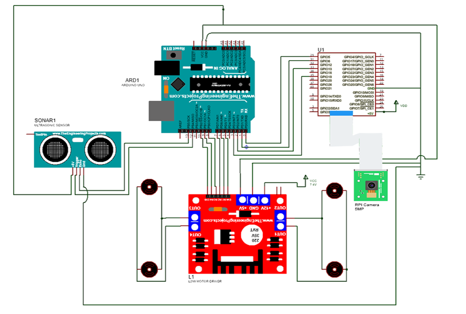

# Self-Driving Car Based on Computer Vision

A small autonomous car prototype built on a Raspberry Pi 3B+ and an Arduino Uno R3. The Raspberry Pi processes camera frames to follow lane markings and detect stop signs and traffic lights with Haar cascade classifiers. It then sends a 4-bit command to the Arduino, which drives the motors through an L298N H-bridge. An ultrasonic sensor connected to the Arduino handles obstacle detection.

---

## Features

- **Lane following** using a bird's-eye perspective transform, grayscale and threshold filtering, Canny edge detection, and column histogram peak detection
- **Lane centring**, where the offset between the lane centre and the frame centre selects the steering command
- **Stop sign detection** with a Haar cascade and distance estimation from the bounding-box width
- **Traffic light detection** with a Haar cascade, stopping at a red light until it turns green
- **Obstacle detection** with an HC-SR04 ultrasonic sensor, which stops the car when an object is close
- **Live visualisation** of the original, perspective, and final views

---

## System Architecture

```
    Raspberry Pi 3B+ (master)                       Arduino Uno R3 (slave)
┌──────────────────────────────────┐          ┌────────────────────────────────┐
│ Pi Camera V2.1                   │          │ Reads D0–D3 (4-bit command)    │
│   ► lane / sign / light (OpenCV) │          │   data = 8·D3 + 4·D2 + 2·D1 + D0
│   ► command 0–11                 │  GPIO    │                                │
│   ► GPIO 21–24  ─────────────────┼─────────►│ Command ► motor function       │
│                                  │          │                                │
└──────────────────────────────────┘          │ HC-SR04 ► obstacle stop        │
                                              │                                │
                                              │ PWM + direction ► L298N        │
                                              └───────────────┬────────────────┘
                                                              ▼
                                                  4 × BO DC gear motors
```
## Internal Connection Circuit

[]

---

## Hardware

| Component | Details |
|---|---|
| Main processor (master) | Raspberry Pi 3B+ (1 GB RAM) |
| Camera | Raspberry Pi Camera Module V2.1 (CSI connector) |
| Microcontroller (slave) | Arduino Uno R3 (ATmega328) |
| Motor driver | L298N dual H-bridge |
| Motors | 4 × BO DC gear motors (3–6 V, about 200 RPM at 6 V) |
| Wheels | 4 × BO wheels, 65 mm diameter |
| Obstacle sensor | HC-SR04 ultrasonic sensor |
| Power, Raspberry Pi | 5 V / 2.5 A from a 10000 mAh power bank |
| Power, motors and Arduino | Two 7.4 V lithium-ion packs feeding the L298N. The Arduino is powered from the L298N 5 V output. |
| Traffic light (test setup) | 3-LED model: 3 V supply, 100 Ω resistor, 3 switches |

### Pin Mapping

**Raspberry Pi to Arduino command bus** (WiringPi numbering):

| Raspberry Pi GPIO | Physical header pin | Bit | Arduino pin |
|---|---|---|---|
| 21 | 29 | 0 (LSB) | D0 (pin 0) |
| 22 | 31 | 1 | D1 (pin 1) |
| 23 | 33 | 2 | D2 (pin 2) |
| 24 | 35 | 3 (MSB) | D3 (pin 3) |

The Arduino reconstructs the command as `data = 8·D3 + 4·D2 + 2·D1 + D0`. Connect a common ground between the Raspberry Pi and the Arduino.

**Arduino to L298N and sensor:**

| Function | Arduino pin | L298N / sensor pin |
|---|---|---|
| Left motor enable (PWM) | 5 | ENA |
| Left motor direction | 6 (HighL), 7 (LowL) | IN1, IN2 |
| Right motor enable (PWM) | 10 | ENB |
| Right motor direction | 8 (HighR), 9 (LowR) | IN3, IN4 |
| HC-SR04 trigger | 12 | Trig |
| HC-SR04 echo | 13 | Echo |

---

## Software Dependencies

- Raspberry Pi OS
- OpenCV (C++ API, including `opencv2/objdetect`)
- [raspicam](https://www.uco.es/investiga/grupos/ava/node/40) library for the Pi camera
- [WiringPi](http://wiringpi.com/) for GPIO access
- g++ with C++11 support
- Arduino IDE for uploading the Arduino sketch

```bash
sudo apt-get update
sudo apt-get install libopencv-dev wiringpi
```

---

## Repository Structure

```
.
├── src/
│   └── main.cpp                # Vision pipeline, decision logic, GPIO output
├── cascades/ # will add them later !!
│   ├── Stop_cascade.xml        # Haar cascade: stop sign
│   └── cascade-TL.xml          # Haar cascade: traffic light
├── arduino/
│   └── Final_code_self_driving_arduino.ino   # Command decoding, L298N control, HC-SR04
├── docs/
│   ├── thesis.pdf # will be added later  !!
│   └── media/ #video of the project will be added later
└── README.md
```

---

## Building and Running

```bash
g++ -std=c++11 src/main.cpp -o vehicle \
    `pkg-config --cflags --libs opencv4` \
    -lraspicam -lraspicam_cv -lwiringPi -lpthread
```

Use `opencv` instead of `opencv4` with OpenCV 3.

1. Upload `arduino/Final_code_self_driving_arduino.ino` to the Arduino Uno with the Arduino IDE.
2. Copy the cascade files to `/home/pi/Desktop/`, or update the paths in `main.cpp`.
3. Power the Raspberry Pi from the power bank and the motors from the lithium packs.
4. Run the program:

```bash
sudo ./vehicle
```

`sudo` is required for GPIO access.

---

## How It Works

### 1. Lane detection
A trapezoidal region of interest in the lower part of the frame is warped to a bird's-eye view. The warped image is converted to grayscale and thresholded with `inRange(frameGray, 170, 250, ...)`. Canny edge detection is then applied with `Canny(frameGray, frameEdge, 900, 900, 3, false)`. A column histogram locates the left and right lane lines.

### 2. Lane centring

```
laneCenter = (RightLanePos − LeftLanePos) / 2 + LeftLanePos
frameCenter = 188
Result      = laneCenter − frameCenter
```

A value of 0 means the car is centred and drives straight. The sign and size of `Result` select a steering command.

### 3. Motor commands
The Raspberry Pi sends a 4-bit number on GPIO 21–24. The Arduino decodes it and calls the matching motor function.

| Command | Arduino function | Behaviour |
|---|---|---|
| 0 | `Forward0()` | Straight, PWM 130 on both motors |
| 10 | `Forward()` | Straight, PWM 120 on both motors |
| 1, 2, 3 | `Right1()`, `Right2()`, `Right3()` | Turn right, increasing sharpness |
| 9 | `Right4()` | Sharpest right turn |
| 4, 5, 6 | `Left1()`, `Left2()`, `Left3()` | Turn left, increasing sharpness |
| 8 | `Left4()` | Sharpest left turn |
| 7 | `Stop()` | Stop (red light) |
| 11 | Stop-sign routine | Stop for 3 s, then drive forward for 1 s so the sign is not detected again |

Each turn slows one side's motor and speeds up the other.

### 4. Stop sign detection
A Haar cascade runs on a 400×240 region of interest after grayscale conversion and histogram equalisation. Distance is estimated from the bounding-box width:

```
dist_Stop = −0.32 × width + 35    (cm)
```

The coefficients come from a linear fit using two calibration distances. When the estimate is between 5 and 20 cm, the Raspberry Pi sends command 11.

### 5. Traffic light detection
A second Haar cascade detects the light, with this distance estimate:

```
dist_Traffic = −1.07 × width + 80.27    (cm)
```

Grayscale processing made red and green hard to tell apart, so a white square was added around the green light in the training data. This reduced false positives. When the estimate is between 5 and 20 cm and a red light is detected, the Raspberry Pi sends command 7, and the car stops until the light turns green.

### 6. Obstacle detection
The HC-SR04 is connected to the Arduino. Distance is computed from the echo pulse:

```
distance = duration × 0.034 / 2
```

When an object is within 15 cm, the Arduino calls `Stop()`. The car resumes once the path is clear.

---

## Trained Models

| File | Detects | Window size | Training |
|---|---|---|---|
| `cascades/Stop_cascade.xml` | Stop sign | See XML | `opencv_traincascade` |
| `cascades/cascade-TL.xml` | Traffic light | See XML | `opencv_traincascade` |

Both cascades were trained on a custom dataset collected by us for this project. The dataset is not included in this repository. You can use your own dataset to train your own cascade model.

### Training your own cascade

1. Collect positive images (the object, cropped or annotated) and negative images (scenes without the object).
2. Create the samples and the positive vector file:
   ```bash
   opencv_createsamples -info positives.txt -vec positives.vec -w 24 -h 24
   ```
3. Train the cascade:
   ```bash
   opencv_traincascade -data cascade_out -vec positives.vec -bg negatives.txt \
       -numPos 500 -numNeg 1000 -numStages 15 -w 24 -h 24
   ```
4. Copy the resulting `cascade.xml` into `cascades/` and rename it to match the path in `main.cpp`.

Set `-w` and `-h` to the window size you use in the code, and adjust `-numPos` and `-numNeg` to the number of images you have.

---

## Results

Tests were run on a track with two white lane lines, a stop sign, a 3-LED traffic light, and obstacles.

| Test | Observed behaviour |
|---|---|
| Lane following | Stable on straight sections and wide turns. Struggles on sharp or wavy turns. Occasional errors when car speed outpaces Pi processing. |
| Stop sign | Detected at a distance. The car stops before the sign. |
| Traffic light | Red light detected, and the car stops about 6 cm before it. Green light is not treated as a stop signal, so the car continues. |
| Obstacles | The car stops short of the object and resumes when it is removed. |

Full methodology and discussion are in the thesis, Chapter IV. To request a copy, contact me at on my Linkedin.

---

## Limitations and Future Work

- Lane detection is sensitive to lighting changes.
- Sharp or wavy turns are hard to follow at speed.
- Haar cascades produce false positives, so a more robust detector would help.
- Latency between sensing and actuation limits performance. A faster processor is recommended.

Planned improvements:
- Load the cascade files once at startup instead of on every frame.
- Replace the `goto` in the decision logic with a state machine.
- Move file paths into a config file.
- Add reinforcement learning for traffic situations and additional sensors.

---

## Authors

- Aguenarous Mohamed
- Derghaoui Sid Ahmed
- Ticherafi Fouad

---

## Demo

[](link)

